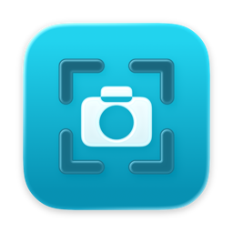
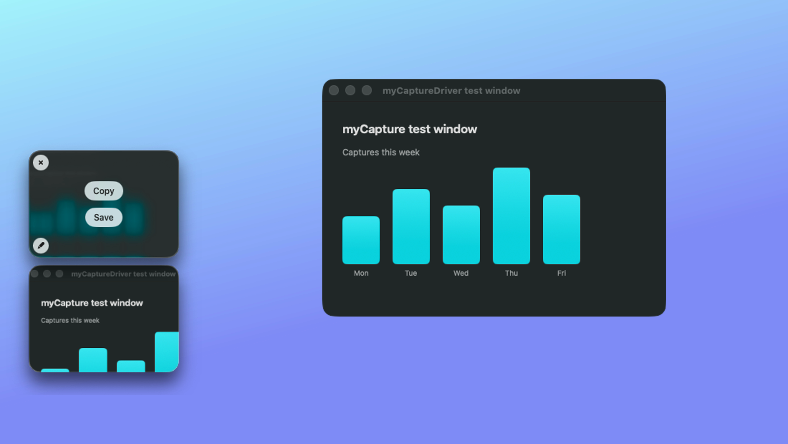

# myCapture

A small screenshot tool for macOS 26, built for one person: me.



> [!NOTE]
> **Personal project.** myCapture is my own small screenshot tool, with only the features I use. The code is public in case it's useful to someone; I build it for my own Mac, so there are no releases, no roadmap and no support. **Pull requests are not accepted** — fork it and make it yours. Bug reports are welcome (see [CONTRIBUTING](CONTRIBUTING.md)).

## What it does

- **Capture an area or a window** with macOS's own selection tool: the size label, <kbd>Space</kbd> for window mode, <kbd>⇧</kbd> and <kbd>⌥</kbd> while you drag. Hold <kbd>⌘</kbd> for a crosshair and a magnifier for pixel-exact edges.
- **A floating thumbnail** at the bottom-left of the screen after each capture: drag it into any app, Copy, Save, or close it. Nothing is saved until you ask. Closed by mistake? Restore brings it back.
- **Arrows on a capture**: double-click the thumbnail (or its pencil button) to open the editor. Draw, move and restyle arrows; closing the editor keeps them in the capture, without a question. They stay editable when you open it again.
- **Capture History**: every capture of the last 3 days (1 day to 1 month, or off, in Settings), newest first, in a glass strip at the top of the screen; the pointer selects a card. Bring one back as a thumbnail, copy it, annotate it or drag it out.
- **Area to clipboard** in one step: the clipboard gets the file and the image, so Finder and chat apps paste a file and image editors paste the picture.
- **Freeze the screen** (Settings, off by default) to capture menus and tooltips that close when the mouse moves.
- **Well-named files**: `26-10-12 19.26.43 Safari - Pull requests.png`, with the app and window title of what you captured. PNG at full resolution, marked as a screenshot for Finder and Spotlight.
- **Private**: everything stays on your Mac. No network access, no accounts, no telemetry.

### Not included, on purpose

Annotation tools other than arrows, text recognition (OCR), screen recording, full-screen, scrolling and timed captures, cloud upload, pinning to the screen.

## Keyboard

Each shortcut can be changed in Settings, which shows Hyper (⌃⌥⇧⌘) as ✦.

| Key | Action |
| --- | --- |
| <kbd>⌃</kbd><kbd>⇧</kbd><kbd>⌘</kbd><kbd>A</kbd> | Capture an area to a thumbnail |
| <kbd>⌃</kbd><kbd>⇧</kbd><kbd>⌘</kbd><kbd>Q</kbd> | Capture an area to the clipboard |
| <kbd>⌃</kbd><kbd>⇧</kbd><kbd>⌘</kbd><kbd>W</kbd> | Capture a window to a thumbnail |
| <kbd>⌃</kbd><kbd>⇧</kbd><kbd>⌘</kbd><kbd>H</kbd> | Open or close Capture History |
| No default (set it in Settings) | Restore the last closed thumbnail |

While you select an area:

| Key | Action |
| --- | --- |
| <kbd>Space</kbd> before you click | Switch to window capture |
| <kbd>Space</kbd> held while you drag | Move the selection |
| <kbd>⇧</kbd> / <kbd>⌥</kbd> while you drag | Lock an edge / resize from the center |
| <kbd>⌘</kbd> held | Crosshair and magnifier |
| <kbd>Esc</kbd> | Cancel |

On a thumbnail, with the pointer on it:

| Key or click | Action |
| --- | --- |
| Copy, <kbd>⌘</kbd><kbd>C</kbd> | Copy and close; <kbd>⌥</kbd>-click Copy keeps it open |
| Save, <kbd>⌘</kbd><kbd>S</kbd> | Save to the screenshots folder and close; <kbd>⌥</kbd>-click Save asks where |
| Drag | Drop the file into any app; the thumbnail closes (<kbd>⌥</kbd> keeps it) |
| <kbd>Space</kbd> | Quick Look |
| Double-click, pencil button | Annotate |
| <kbd>Esc</kbd>, <kbd>⌘</kbd><kbd>W</kbd>, Close | Close |
| Right-click | Annotate, Copy, Save, Save As…, Close |

In Capture History:

| Key or click | Action |
| --- | --- |
| <kbd>←</kbd> <kbd>→</kbd>, click | Select a capture |
| <kbd>Return</kbd> | Show it as a thumbnail again |
| <kbd>Space</kbd> | Quick Look |
| <kbd>⌘</kbd><kbd>C</kbd> | Copy and close |
| <kbd>⌘</kbd><kbd>E</kbd>, double-click | Annotate |
| <kbd>⌫</kbd> | Remove from the history (a saved file stays) |
| Drag | Drop the file into any app; the strip closes when the pointer leaves it |
| <kbd>Esc</kbd>, <kbd>⌘</kbd><kbd>W</kbd> | Close |
| Right-click | Restore, Annotate, Copy, Remove from History |

In the editor:

| Key or click | Action |
| --- | --- |
| Drag | Draw an arrow; with <kbd>⇧</kbd> at 45° steps |
| Click an arrow, drag | Select and move it; drag an end to change it; <kbd>⌥</kbd>-drag moves a copy |
| <kbd>←</kbd> <kbd>→</kbd> <kbd>↑</kbd> <kbd>↓</kbd> | Move the selected arrow 1 pt; with <kbd>⇧</kbd> 10 pt |
| <kbd>⌫</kbd> | Delete the selected arrow |
| <kbd>⌘</kbd><kbd>Z</kbd> / <kbd>⇧</kbd><kbd>⌘</kbd><kbd>Z</kbd> | Undo / Redo |
| <kbd>V</kbd> / <kbd>A</kbd> | Move tool (select and move only) / Arrow tool |
| Save As…, <kbd>⇧</kbd><kbd>⌘</kbd><kbd>S</kbd> | Save a copy where you pick, and close |
| <kbd>⌥</kbd>-click Save As… (it shows Save), <kbd>⌘</kbd><kbd>S</kbd> | Save a copy to the screenshots folder, and close |
| Copy, <kbd>⇧</kbd><kbd>⌘</kbd><kbd>C</kbd> | Copy and close; <kbd>⌥</kbd>-click Copy keeps the editor open |
| <kbd>Esc</kbd> | Deselect; with nothing selected, close |
| Close button, <kbd>⌘</kbd><kbd>W</kbd>, <kbd>⌘</kbd><kbd>Q</kbd> | Close the editor; the changes stay in the capture |
| Drag Me | Drag the result into any app; a click closes the editor |
| Right-click | Undo, Redo, Delete, Copy, Save, Save As…, Close |

## Install (from source)

Needs macOS 26 and Xcode 26.

```sh
git clone https://github.com/sitek94/mycapture && cd mycapture
MYCAPTURE_SIGN_IDENTITY="Apple Development" scripts/bundle.sh install
```

`bundle.sh` builds a release binary, wraps it as `myCapture.app`, signs it and installs it to `~/Applications`. Sign with a stable identity (any *Apple Development* certificate from a free Apple account works) so macOS remembers the Screen Recording permission across rebuilds. Without one, use `MYCAPTURE_SIGN_IDENTITY=-` for an ad-hoc signature and expect to grant it again after every build.

### Permissions

- **Screen Recording** (System Settings → Privacy & Security): needed for every capture and for window titles in file names. The first capture asks for it; Settings shows its state.

## Develop

```sh
scripts/check.sh    # format, lint, build, tests
scripts/smoke.sh    # the main flows in a test build, on its own test window only
```

Use `xcrun swift`, not a `swift` from elsewhere on your `PATH`: the package needs Xcode 26's toolchain.

- `scripts/smoke.sh` quits the installed myCapture while it runs and restarts it at the end. It captures only the driver's own test window and saves its screenshots to `build/smoke`.
- Shared parts (tokens, panels, shortcuts, Settings) come from [myKit](https://github.com/sitek94/mykit); its [gotchas](https://github.com/sitek94/mykit/blob/main/docs/gotchas.md) cover focus, permissions and building.
- The icon is an Icon Composer document: a gradient and our own glyph (`Sources/MyCapture/Glyph.swift`; `scripts/make-icon.sh` rebuilds the icon, and the menu bar icon uses the same drawing). `bundle.sh` compiles it with `actool`.

## License

[MIT](LICENSE)
